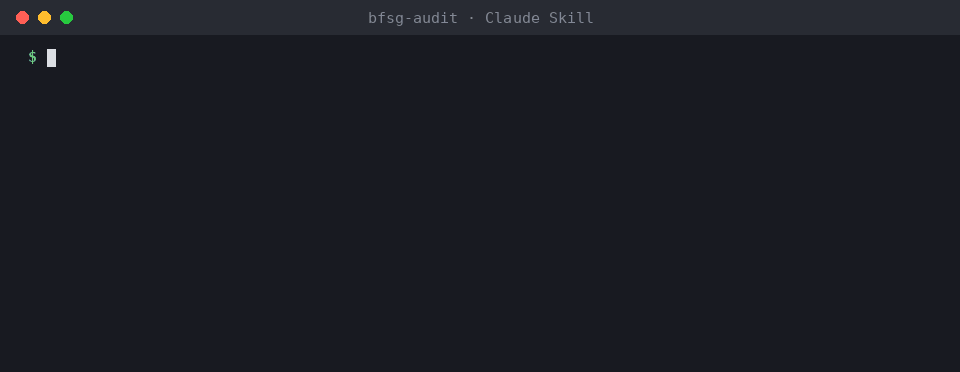

# BFSG-Audit

**Ein Claude-Skill, der Websites und Online-Shops auf digitale Barrierefreiheit nach dem Barrierefreiheitsstärkungsgesetz (BFSG) prüft — und dir sagt, was du im Code ändern musst.**

[English version below](#english)



<sub>Gekürzte Darstellung echter Scan-Ergebnisse für `tests/fixtures/shop-schlecht` und der reparierten Fassung `tests/fixtures/shop-repariert`.</sub>

Seit dem 28.06.2025 müssen viele Online-Shops und Buchungsseiten in Deutschland barrierefrei sein. Die meisten Tools sagen dir *dass* etwas fehlt. Dieser Skill sagt dir:

1. **Ob das BFSG für die Seite überhaupt gilt** — B2C-Vertragsschluss? Kleinstunternehmen? Ausnahmen? Alles mit Fundstelle im Gesetz.
2. **Was genau kaputt ist** — jeder Befund mit WCAG-Kriterium, Datei und Zeile, und wen die Barriere trifft.
3. **Wie der Fix aussieht** — konkreter Code im Stil deines Projekts (HTML, React, Vue, Svelte, Astro …).
4. **Was rechtlich zusätzlich verlangt ist** — die Informationen zur Barrierefreiheit nach Anlage 3 BFSG, ehrlich aus dem Prüfergebnis erstellt.

> **Keine Rechtsberatung.** Technische Vorprüfung. Ein Code-Audit kann Barrieren finden, aber keine Konformität bescheinigen — Kontrast, Screenreader-Verhalten und Inhalte brauchen Tests im Browser und mit Menschen. Bei rechtlichen Fragen: Anwältin/Anwalt.

Ausführliche Anleitung: [docs/anleitung.md](docs/anleitung.md) · Datenschutz: [PRIVACY.md](PRIVACY.md)

## Installation

### Claude Code

```
/plugin marketplace add sjanasek/bfsg-audit
/plugin install bfsg-audit@sjanasek
```

### Manuell / Claude.ai

Den Ordner `skills/bfsg-audit/` nach `~/.claude/skills/` (global) oder `.claude/skills/` (Projekt) kopieren — oder das ZIP aus den Releases in Claude.ai unter *Einstellungen → Skills* hochladen.

## Nutzung

Einfach fragen:

```
Prüf meinen Shop auf BFSG — der Code liegt in ./shop
Muss meine Portfolio-Seite eigentlich barrierefrei sein?
Check https://example.de auf Barrierefreiheit
Schreib die Barrierefreiheitserklärung für unseren Shop
```

### Der Scanner allein

Keine Abhängigkeiten, nur Python 3.9+:

```bash
python3 skills/bfsg-audit/scripts/scan.py ./mein-projekt
python3 skills/bfsg-audit/scripts/scan.py https://example.de
python3 skills/bfsg-audit/scripts/scan.py ./mein-projekt --json
```

Er findet statisch u. a.: Bilder ohne Alternativtext, Formularfelder ohne Label, klickbare `div`s, Buttons/Links ohne Namen, entfernte Fokus-Rahmen, gesperrten Zoom, fehlende Sprache, Autoplay, blockiertes Einfügen in Passwortfelder, fehlendes `autocomplete`, positive `tabindex`, Overlays — in HTML, JSX/TSX, Vue, Svelte, Astro, PHP und CSS. Außerdem Indizien, ob die Seite ein Shop ist, und ob Barrierefreiheitsinformationen existieren.

Was statisch nicht geht (Kontrast, Tastaturfallen, Screenreader), listet er ausdrücklich als "manuell zu prüfen" auf. Im Skill wird dafür, wenn möglich, zusätzlich [axe-core](https://github.com/dequelabs/axe-core) im Browser ausgeführt.

## Was drin ist

```
skills/bfsg-audit/
├── SKILL.md                                  Ablauf: Anwendungsbereich → Scan → Runtime → Bericht → Fixes
├── references/rechtsrahmen.md                BFSG/BFSGV-Fakten, jede mit Fundstelle geprüft (Stand 18.10.2026)
├── references/wcag-pruefliste.md             WCAG 2.1 AA + 2.2, Brennpunkte Login/Checkout/Zahlung (§ 19 BFSGV)
├── references/fix-muster.md                  Code-Muster für die häufigsten Barrieren
├── assets/barrierefreiheitsinformationen.md  Vorlage nach Anlage 3 BFSG
└── scripts/scan.py                           Statischer Scanner (nur Standardbibliothek)
```

## Rechtsstand

Geprüft am amtlichen Text (gesetze-im-internet.de) mit Stand **18.10.2026**: §§ 1, 2, 3, 14, 17, 37, 38 und Anlage 3 BFSG, §§ 12, 19 BFSGV. Maßstab ist WCAG 2.1 AA, die De-facto-Referenz über EN 301 549 V3.2.1. Eine im EU-Amtsblatt zitierte harmonisierte Norm zum BFSG/EAA gibt es noch nicht; die neue EN 301 549 V4.1.1 (WCAG 2.2, September 2026) ist ebenfalls noch nicht zitiert. Die WCAG-2.2-Kriterien prüft der Skill bereits als Empfehlung mit.

Rechtsänderung entdeckt? Bitte ein Issue mit Quelle (Gesetzestext, Urteil mit Aktenzeichen, Behördendokument) eröffnen.

## Datenschutz und Impressum?

Bewusst nicht Teil dieses Skills. Für DSGVO, Cookie-Einwilligung (§ 25 TDDDG) und Impressum (§ 5 DDG) gibt es spezialisierte Skills, z. B. [dsgvo-audit](https://github.com/lxhelili/dsgvo-audit).

## Mitmachen

Issues und Pull Requests sind willkommen — besonders:
- neue statische Prüfregeln mit Test in `tests/`
- Fix-Muster für weitere Frameworks und Shopsysteme (Shopify, WooCommerce, Shopware)
- Rechtsupdates mit Primärquelle

Tests: `python3 -m unittest discover tests`

## Lizenz

MIT — siehe [LICENSE](LICENSE).

---

<a id="english"></a>

## English

**A Claude skill that audits websites and online shops for digital accessibility under Germany's Accessibility Strengthening Act (BFSG, the German implementation of the European Accessibility Act) — and tells you exactly what to change in your code.**

1. **Does the BFSG apply?** B2C contracts, micro-enterprise exemption, content exceptions — each with a statutory reference.
2. **What is broken?** Every finding with WCAG success criterion, file and line, and who is affected.
3. **How to fix it.** Concrete code in your project's style.
4. **The mandatory accessibility information** (Annex 3 BFSG), generated honestly from the audit results.

Reports are written in German, since that is what clients and authorities in Germany need. The chat can be in any language.

> **Not legal advice.** A technical pre-check. A code audit finds barriers; it cannot certify conformance.

**Install (Claude Code):**
```
/plugin marketplace add sjanasek/bfsg-audit
/plugin install bfsg-audit@sjanasek
```

**Scanner only (Python 3.9+, no dependencies):** `python3 skills/bfsg-audit/scripts/scan.py <folder|url> [--json]`

License: MIT.
